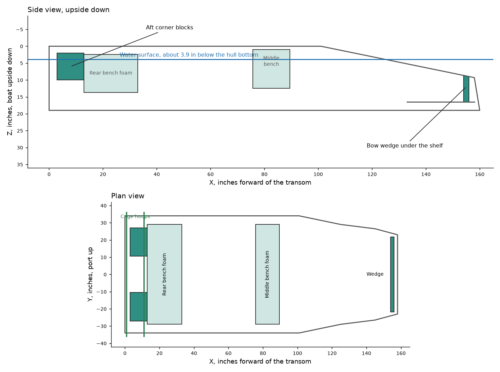

# Capsized Flotation Analysis — v1.0.1.0

**Boat:** minimal 1448, Rotax 800R E-TEC, Onshape version v1.0.1.0-structural
**Condition:** upside down in fresh water, driver swimming, 6 gal tank full, 200 lb of gear strapped behind the driver
**Model:** `CAD/analysis/flotation_inverted.js`
**Status:** a hobby design calculation from estimated weights, with the bench foam as reported from inspection: both benches full and sound. It has not been checked by a licensed professional or tested in the water. Use it at your own risk.

## Result

The boat floats level upside down, like a raft, with the hull bottom about **3.9 in** out of the water. It sits level within about 0.3° in pitch and roll. The foam in the two benches does most of the work, about 11.7 ft³ after the dry box and harness sleeve are cut in. Only **1.94 ft³ (3.9 lb)** of new foam is needed:

| New foam, 2 lb/ft³ closed-cell | Size | Volume | Position |
|---|---|---|---|
| Bow wedge | 2 x 43.6 in, about 7.5 to 7.9 in deep | 0.41 ft³ | Under the front shelf, X 154–156, at the forward end |
| Port corner block | X 3–13, Y 10.5 out to the hull side, Z 2–10 | 0.76 ft³ | Inside the hull, aft of the rear bench |
| Starboard corner block | The same, mirrored | 0.76 ft³ | Inside the hull, aft of the rear bench |

No foam goes outside the hull, so there's no drag, no extra width, and nothing to catch the water in a turn.

| Effect on the boat | Before | With foam |
|---|---|---|
| Equipment | 464.1 lb | 468.0 lb |
| Payload against the 350 lb needed | 360.9 lb | 357.0 lb, **7.0 lb spare** |
| Top speed | 34.5 mph | 34.5 mph |
| Dock trim, with 150 lb of gear | 0.95° | 0.97° |
| BOM | about $15,575 | about $15,655 |

**Change from the first version of this report.** It gave 2.8 ft³ for full benches, with the starboard corner block taller than the port one. Rechecked against the build, that left the boat listing about 2.5°. Making the two blocks the same height removes the list and saves 0.8 ft³.

## Method

The hull is open, so upside down it floods and gives no buoyancy of its own. I took **no credit** for air trapped under the hull, or for the sealed dry box.

Each item under water weighs its dry weight less the water it displaces, and items above water weigh their full dry weight. The foam was modeled in 1 in cubes, with the dry box and harness sleeve cut out of the middle bench. The float height, heel and pitch were then found by balancing weight and buoyancy.

Foam has to reach the surface for the boat to hold a level float height. The bench foam and corner blocks do this, starting about 2 in from the hull bottom. That is why the boat floats so level with so little new foam, and why blocks high up beside the cage hoops don't work.

| Group | Dry weight, lb |
|---|---|
| Hull and benches | 248 |
| Engine, exhaust, belt, prop | 182 |
| Stand, cage, rudders, brackets | 127 |
| Outfit, wiring, strips, rail | 110 |
| Fuel and tank | 45 |
| Gear, no credit for its volume | 200 |
| New foam | 4 |
| Bench foam, counted again to be safe | 23 |
| **Total** | **939** |

The hull figure probably already includes the bench foam, so counting it again adds a little margin. The center of gravity is at about X 48.5, Z 18.4.

## Stability

These are righting arms in inches. Positive pushes the boat back to level.

| Heel | 5° | 10° | 20° | 30° |
|---|---|---|---|---|
| To port | 2.1 | 3.5 | 5.4 | 7.3 |
| To starboard | 2.3 | 3.7 | 5.6 | 7.5 |

| Pitch | 3° | 6° |
|---|---|---|
| Bow down | 4.6 | 6.8 |
| Bow up | 4.5 | 7.0 |

All are positive and nearly even from side to side and end to end, so the boat returns to level.

## Reserve and sensitivity

Total lift with everything under water is about 1,174 lb against 939 lb of weight, which leaves about **235 lb of reserve**.

| Change | Effect |
|---|---|
| Bench foam 90% as good as assumed | Hull bottom 2.9 in clear, still stable |
| Bench foam 80% as good as assumed | Hull bottom 1.75 in clear, still stable |
| Driver climbs on, 200 lb at X 82 | Hull bottom about awash, level in roll, and it pitches bow down. Hold on from the water instead |
| Salt water | Floats about 0.4 in higher |

## Build notes

- **Foam:** closed-cell, 2 lb/ft³, fuel resistant. Use polyethylene, or XPS sealed in a fuel-proof skin. Plain beadboard soaks up water, and gasoline dissolves it.
- **Bench foam:** keep it intact. Cut only the dry box opening, the harness sleeve and the small rear access pocket, and seal the cut faces.
- **Strapping:** upside down, the foam presses against the hull, so the straps only need to hold the blocks in place in normal use. Use stainless or aluminum hardware.
- **Heat:** the port block's top is about 6.5 in below the tailpipe. Put a 0.040 in aluminum shield between them, or trim the block to keep 9 in.
- **Bilge:** keep the blocks clear of the pump and hose, and off the floor, so water drains under them.
- **Trim:** the wedge is the fine adjustment. Add or remove a little on the real boat to level it in pitch.

## Limits of this analysis

- **Weights** are estimates until parts are weighed.
- **Bench foam** is taken as the full bench volume, from your inspection of it. Volumes come from the reference hull.
- **Water soaking:** foam takes on water over years, so recheck the benches now and then.
- **Capsize itself:** this is the settled condition only. It doesn't cover the capsize, a hot engine going under, or righting the boat.
- **Fuel:** a tank upside down can leak through its vent and fittings. Treat the water around a capsized boat as a fire risk.
- **Rules:** this isn't USCG flotation compliance.

## Alternatives checked

| Bench foam | New foam needed | Notes |
|---|---|---|
| Half full | 6.7 ft³, 13 lb, with side blocks | 2 lb short on payload |
| Empty | 12.0 ft³, 24 lb, with 30 x 16 x 16 in blocks outside the hull | 13 lb short on payload, 101 in wide, and the blocks can catch the water at about 3° of heel |

## Next step

Roll the finished boat in shallow water, with a crane or helpers, and check the float attitude. Trim the wedge to suit.
